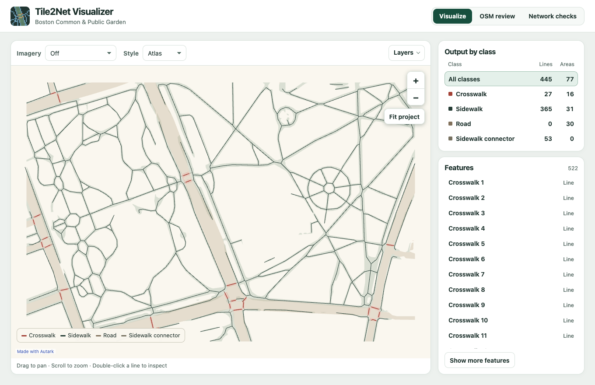
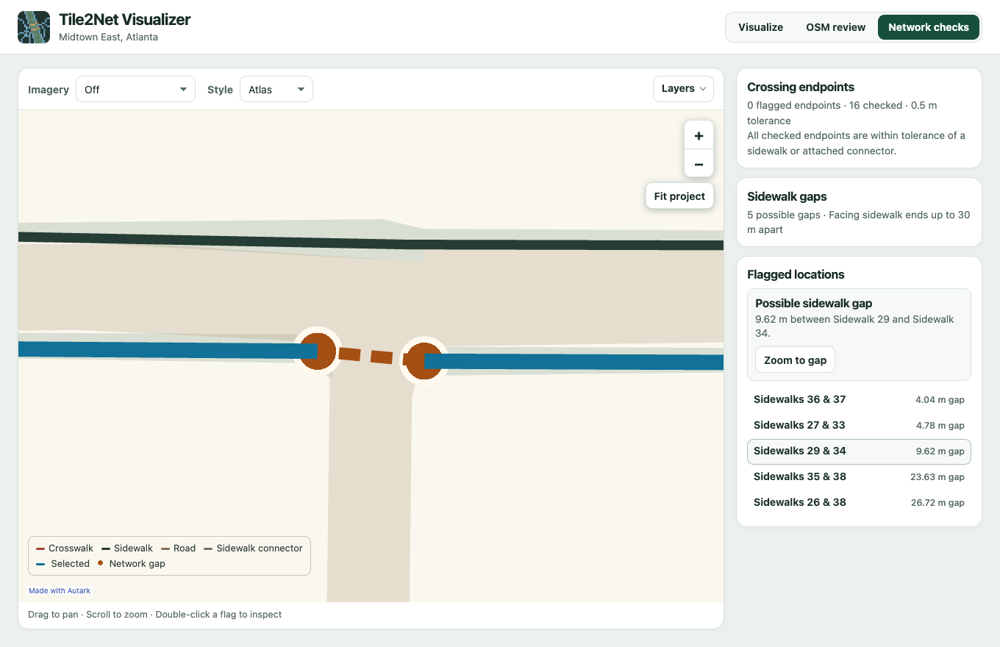
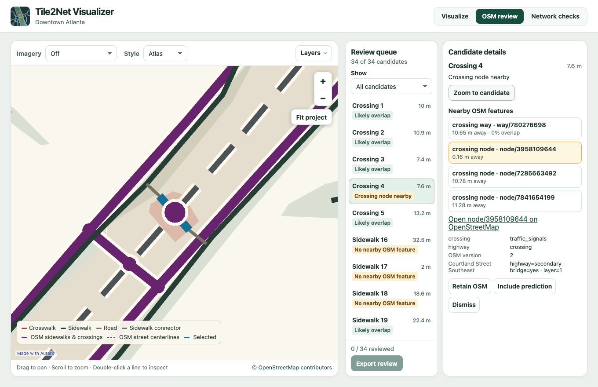

# Tile2Net Visualizer

Explore Tile2Net's sidewalk and crossing network alongside its segmentation polygons, source imagery, and optional OpenStreetMap (OSM) data. The viewer runs locally in a WebGPU-capable browser.



## Quick start

Start with a completed Tile2Net run and a built [Autark](https://github.com/urban-toolkit/autark) checkout containing `autk-map/dist/autk-map.js`. From the Tile2Net repository, pass the run's `tiles/*_info.json` and a new output directory.

```sh
uv run --python 3.12 python examples/autark-viewer/prepare.py \
  ./runs/boston/tiles/boston_256_info.json \
  --autark ../autark --title "Boston Common & Public Garden" \
  --imagery-label "MassGIS 2021 aerial imagery" --output ./boston-viewer

python3 -m http.server 8769 --bind 127.0.0.1 --directory ./boston-viewer
```

Open [localhost:8769](http://127.0.0.1:8769/). Add `--fetch-osm` when preparing a small area, or pass a local snapshot with `--osm snapshot.osm`. Use `--reference traces.geojson` to overlay hand-traced features.

Use **Layers** to toggle map overlays and **Imagery** to switch between the Tile2Net input, Esri World Imagery, and a plain background.

## Examples

**Boston Common and Public Garden.** Generate the sample below, then use the quick start. Choose **Style → Atlas** to see the park paths and the paired crossings on Charles Street. Click a feature in the sidebar to zoom to it. [Atlas palette and drawing order](atlas-style.md)

```sh
uv run --python 3.12 python -m tile2net generate \
  --name boston --source ma --zoom 19 --output ./runs \
  --location '42.3555519,-71.0716892,42.3536484,-71.0643742' |
  uv run --python 3.12 python -m tile2net inference --local --eval test --device cpu
```

Use `--device mps` on an Apple GPU or `--device cuda` on a CUDA GPU.

**Midtown Atlanta.** Prepare a [GeoTIFF run](../../README.md#benchmarking-a-local-crop) the same way. Open **Network checks** and select a flag to inspect a crossing endpoint or a possible sidewalk gap. The default crossing tolerance is 0.5 m. The sidewalk check looks for facing ends up to 30 m apart.



## OSM review

Prepare the project with `--osm snapshot.osm` or `--fetch-osm`, then open **OSM review**.

1. Pick a sidewalk or crossing in the queue and click **Zoom to candidate**.
2. Select a nearby OSM feature to see its distance, overlap, tags, and link to OpenStreetMap. Overlap is the share of the Tile2Net line within 3 m of the OSM way. Solid purple marks mapped sidewalks and crossings. Dashed charcoal marks street centerlines with sidewalk tags.
3. Choose **Retain OSM** or **Include prediction** to select a geometry, or **Dismiss** to record a decision and skip the feature. Decisions are saved in your browser.

**Export review** downloads the selected features and their review decisions as GeoJSON. Retained OSM features carry their original IDs and tags.


